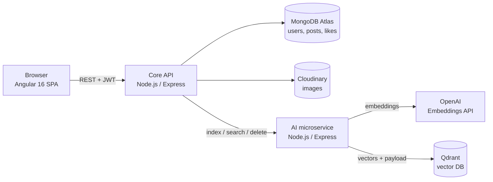

# Anonybook

**An AI-powered social platform with semantic search.** Built with Angular 16, a Node.js/Express API on MongoDB, and a separate AI microservice that does retrieval with OpenAI embeddings and the Qdrant vector database.

[](https://my-mean-project-gamma.vercel.app)


**Live demo:** https://my-mean-project-gamma.vercel.app
**AI microservice:** [maaz-azhar-9/ai-post-suggestion](https://github.com/maaz-azhar-9/ai-post-suggestion)

---

## Features

- **Semantic search (RAG retrieval):** posts are matched by meaning, not keywords. You can search in natural language, in any language.
- **Posts with images:** create, edit, delete and paginate posts. Images are compressed in the browser and stored on Cloudinary.
- **Likes:** per-user likes with a dedicated API.
- **Authentication:** email/password sign-up (bcrypt-hashed), **Google Sign-In**, and stateless **JWT** sessions with route guards.
- **Global error handling:** an Angular HTTP interceptor and toast notifications.
- **UI:** Angular Material + Tailwind CSS.

## Architecture



The core API and the AI service are **deployed separately**, so an outage or slowdown in the embedding pipeline doesn't take down posting, auth or the feed. Each service can also scale on its own.

### How semantic search works

1. **Index:** when a post is created, the core API sends its title and content to the AI service. The AI service generates an OpenAI embedding and upserts it into Qdrant with `{ postId, userId, postTitle, createdAt }` as the payload.
2. **Query:** the search text is embedded with the same model.
3. **Retrieve:** Qdrant returns the top-K nearest posts by cosine similarity.
4. **Delete:** deleting a post removes its vector, so search results stay consistent.

## Tech stack

| Layer | Tech |
|---|---|
| Frontend | Angular 16, TypeScript, RxJS, Angular Material, Tailwind CSS |
| Core API | Node.js, Express, Mongoose, JWT, bcrypt, Multer |
| AI service | Node.js, Express, OpenAI SDK, Qdrant JS client |
| Data | MongoDB Atlas, Qdrant, Cloudinary |
| Hosting | Vercel (frontend), separate Node.js hosts for the API and AI service |

## API overview

| Method | Endpoint | Auth | Description |
|---|---|---|---|
| `POST` | `/api/user/signup` | No | Register with email and password |
| `POST` | `/api/user/login` | No | Log in and receive a JWT |
| `POST` | `/api/user/googleOAuth` | No | Exchange a Google access token for a JWT |
| `GET` | `/api/posts` | No | Paginated feed |
| `GET` | `/api/posts/:id` | Optional | Single post |
| `POST` | `/api/posts` | Yes | Create a post (multipart, with image) |
| `PUT` | `/api/posts/:id` | Yes | Update a post |
| `DELETE` | `/api/posts/:id` | Yes | Delete a post |
| `POST` | `/api/posts/semanticSearch` | No | Semantic search across posts |
| `POST` | `/api/like/:postId/:userId` | Yes | Like a post |
| `DELETE` | `/api/like/:postId/:userId` | Yes | Remove a like |

## Getting started

### Prerequisites

Node.js 18+, a MongoDB Atlas cluster, a Cloudinary account, and a running instance of the [AI microservice](https://github.com/maaz-azhar-9/ai-post-suggestion), which needs an OpenAI key and a Qdrant cluster.

### Setup

```bash
git clone https://github.com/maaz-azhar-9/anonybook.git
cd anonybook
npm install
```

Create `backend/.env`:

```env
MONOGO_ATLAS_PW=your-mongodb-password
JWT_KEY=a-long-random-secret
CLOUDINARY_CLOUD_NAME=...
CLOUDINARY_API_KEY=...
CLOUDINARY_API_SECRET=...
PORT=3000
```

Run:

```bash
npm run start:server   # API on http://localhost:3000
npm start              # Angular on http://localhost:4200
```

## Project structure

```
├── backend/
│   ├── controllers/   # posts, users, likes
│   ├── middleware/    # JWT check, optional auth, Cloudinary upload
│   ├── models/        # Mongoose schemas
│   ├── routes/
│   └── server.js
└── src/app/
    ├── auth/              # login, signup, Google Sign-In, guards
    ├── posts/ post-list/  # create / edit / feed
    ├── semantic-search/   # AI search UI
    ├── error/             # error dialog + interceptor
    └── header/
```

## Roadmap

- [ ] Rate limiting and request validation on public endpoints
- [ ] Unit tests for controllers and services, plus GitHub Actions CI
- [ ] Docker Compose for one-command local setup
- [ ] Hybrid search (BM25 + vectors) and re-ranking

## Author

**Mohd Maaz Azhar**, Senior Angular Developer · [LinkedIn](https://www.linkedin.com/in/mohd-maaz-azhar-57877716b/) · [GitHub](https://github.com/maaz-azhar-9)
